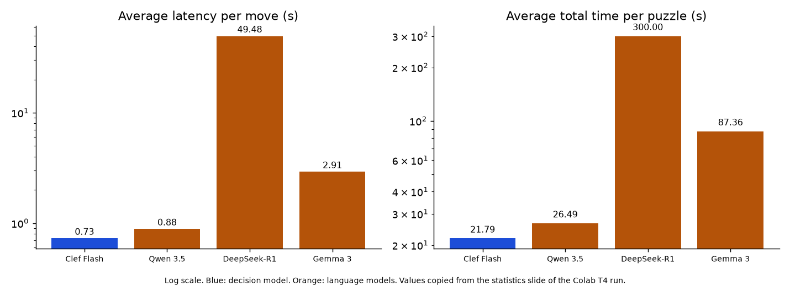

# Rubik's Cube Race

**AI Engineering | Assignment 02 | Urooj Baloch | Roll No. 23K-0071**

## About the Project

Can a fast System-1 decision model solve a Rubik's Cube better than a powerful language model? That is the main question behind **Rubik's Cube Race**.

This project compares four AI models to see how they perform when solving the same Rubik's Cube puzzles. It looks at two main things: how quickly each model makes a decision and how well it solves the cube.

The benchmark measures response time per move, total solving time, success rate, and how close each model gets to the shortest possible solution. The models can run through OpenRouter or locally using Ollama.

The goal is to understand whether a faster decision-making model can compete with larger language models on a task that requires a sequence of correct decisions.

## Demo Screen Recording

**(https://github.com/Urooj-Baloch/Rubiks-cube-race/blob/main/demo%20drive%20link.txt)**

The demo shows the four models racing on the same scrambled cube. It includes the race while it is running, the final results for each model, and a statistics slide comparing their performance. My name and roll number are also visible throughout the recording.

<!-- NOTE:START -->
The screen recording (`demo/demo.mp4`) and the results in the Live Run section are from an actual experiment using Ollama models on a Google Colab T4 GPU. The results reflect the performance of the models on that hardware.
<!-- NOTE:END -->

## Features

- **Rubik's Cube engine:** Represents the cube using 54 facelets and supports all 18 standard moves. The move operations are tested against known cube identities.
- **Shortest-solution reference:** Uses bidirectional BFS to calculate the exact shortest solution for puzzles up to six moves deep. This covers the warm-up and primary test puzzles.
- **OpenRouter support:** Includes adapters for the Decisions API and Chat Completions API, allowing the project to work with different model types.
- **Local Ollama support:** Runs Clef Flash, Qwen 3.5, DeepSeek-R1, and Gemma 3 without requiring an OpenRouter API key.
- **Fair comparison:** Every model gets the same starting puzzle and follows the same move limit, timeout, retry rules, and recent-move history settings.
- **Live race interface:** Displays four 3D cubes, timers, move counts, move histories, and the final benchmark results.
- **Automatic reports:** Generates a Markdown report, JSON result files, and benchmark charts.
- **API key protection:** API keys are stored in backend environment variables instead of being exposed to the browser.

## Project Structure

```text
race/cube.py        Cube engine, moves, and scramble generator
race/solver.py      Exact shortest-solution search
race/models.py      Model API adapters
race/runner.py      Benchmark execution and timing
race/stats.py       Statistical calculations
race/analysis.py    Analysis of the five assignment questions
race/report.py      Reports, charts, and README updates
race/server.py      FastAPI server and event streaming
static/             Frontend files and race interface
benchmark.py        Command-line benchmark runner
check_models.py     Model availability checks
demo/demo.mp4       Screen recording
tests/              Automated tests
results/            Generated benchmark results
```

## Getting Started

First, clone the repository and create a Python virtual environment.

```bash
git clone <your-repo-url>
cd rubiks-cube-race
python3 -m venv .venv
source .venv/bin/activate
pip install -r requirements.txt
cp .env.example .env
```

Next, open `.env` and configure the required environment variables, including `OPENROUTER_API_KEY`, `STUDENT_NAME`, and `STUDENT_ROLL`.

The API key is required only when using the OpenRouter backend. Never upload your `.env` file to GitHub.

Before starting the experiment, check whether the configured model IDs are available:

```bash
python check_models.py
```

## Running the Experiment

To run the live benchmark and update the results in this README, use:

```bash
python benchmark.py --mode live --seed a02 --update-readme
```

The default experiment includes two warm-up puzzles, ten primary puzzles, and three extension puzzles for each model, giving a total of 60 trials across four models.

For a smaller experiment, you can reduce the number of primary puzzles. For example:

```bash
python benchmark.py --mode live --primary 5
```

You can also change the random seed to test the models on different scrambles.

## Running the Models Locally with Ollama

The instructor approved Ollama as an alternative to OpenRouter, so the experiment can be run without purchasing API credits.

The submitted experiment uses the following models:

| Model | Purpose | Ollama model tag |
|---|---|---|
| Clef Flash | System-1 decision model | `clef-flash` |
| Qwen 3.5 | Language model | `qwen3.5` |
| DeepSeek-R1 | Language model | `deepseek-r1` |
| Gemma 3 | Language model | `gemma3` |

The original benchmark design also supports models through OpenRouter. However, the submitted Ollama run uses these alternatives because OpenRouter credits were unavailable.

### Setup

1. Install [Ollama](https://ollama.com/download) and make sure it is running.
2. Download the required models:

   ```bash
   ollama pull clef-flash
   ollama pull qwen3.5
   ollama pull deepseek-r1
   ollama pull gemma3
   ```

3. Copy `.env.ollama.example` to `.env` and configure the model tags if needed.
4. Run the model availability check:

   ```bash
   python check_models.py
   ```

5. Run a quick test before starting the full benchmark:

   ```bash
   python benchmark.py --mode live --warmup 1 --primary 1 --extension 0
   ```

6. Start the full experiment:

   ```bash
   python benchmark.py --mode live --seed a02 --update-readme
   ```

The four models take turns using the same machine, so they do not compete for the GPU at the same time. Each model is loaded before its trial begins, meaning model-loading time is excluded from the measured results.

Each move request has a 60-second timeout, and each puzzle has a 300-second time limit. Invalid responses can be retried up to the configured limit.

## Running on Google Colab

If your computer cannot comfortably run the models locally, you can use the provided notebook:

`colab/rubiks_cube_race_colab.ipynb`

Upload it to [Google Colab](https://colab.research.google.com), select **Runtime → Change runtime type → T4 GPU**, and execute the cells in order.

The notebook installs Ollama, downloads the models, runs the benchmark, updates the results, and starts the race interface for recording.

Keep in mind that the measured speed depends on the hardware used. Results obtained on a Colab GPU may differ from results on a personal computer.

## Running the Race Interface

Start the FastAPI server:

```bash
uvicorn race.server:app --port 8000
```

Open `http://127.0.0.1:8000` in your browser. Select Live mode, choose the number of puzzles for each tier, and click **Run benchmark**.

Once the race finishes, the statistics slide opens automatically. You can also reopen it using **Show benchmarks**.

## Recording the Demo

For the assignment submission, the recording should show the complete experiment clearly.

1. Keep the student name and roll number visible.
2. Show all four models while the race is running.
3. Show the final status of each model, including whether it solved the cube or ran out of moves.
4. End with the benchmark statistics slide.
5. Save the recording as `demo/demo.mp4`.

On Windows, you can use `Win + Alt + R` to start or stop a recording with Xbox Game Bar, if available.

## How the Benchmark Works

### Cube representation and moves

The cube is represented by a 54-character string, with nine facelets for each of the six faces: U, R, F, D, L, and B.

Each model receives the current cube state along with the last six moves. It must choose one move from the following 18 possibilities:

`U U' U2 R R' R2 F F' F2 D D' D2 L L' L2 B B' B2`

After every move, the engine updates the cube and checks whether all six faces have a uniform colour.

### Keeping the comparison fair

All four models start with the same scrambled state for each puzzle. They also follow the same move limit, request timeout, retry policy, and move-history settings.

A model that reaches the 30-move limit without solving the cube is counted as unsuccessful. Invalid responses are recorded rather than silently converted into valid moves.

### Performance metrics

The benchmark uses the following measurements:

- **Average per-move latency:** The time taken to receive a valid move, including retries.
- **Median and P95 latency:** Additional measurements showing typical and slower response times.
- **Total solve time:** The time from the first request until the cube is solved or the trial reaches its limit.
- **Success rate:** The percentage of puzzles solved successfully.
- **Optimality gap:** The difference between the number of moves used by a successful model and the exact shortest solution for puzzles whose optimum is known.

A smaller optimality gap means the model found a solution closer to the shortest possible one.

### Test puzzles

The experiment uses three puzzle categories:

- **Warm-up:** Short scrambles of three to four moves.
- **Primary:** Scrambles of four to five moves, with the exact shortest solution calculated by the solver.
- **Extension:** Longer scrambles of 15 to 20 moves, used to test performance on more challenging puzzles.

The exact shortest-solution reference is limited to six moves, so the extension puzzles do not have a computed optimality gap.

## Automated Tests

Run the test suite with:

```bash
python -m pytest -q
```

The project includes 22 automated tests covering cube moves, inverse operations, scramble generation, shortest-solution search, API adapters, invalid responses, retries, and benchmark execution using a mock Ollama server.

These tests help verify that the cube engine and benchmark behave as expected, even when real models are not available.

## Results

### Live Run: Results from Real Models

<!-- RESULTS:LIVE:START -->

**Experiment setup:** The models were run through Ollama on a Google Colab T4 GPU with 15 GB of GPU memory. The experiment used seed `a02`, three primary puzzles with scrambles of four, four, and five moves, a 30-move limit, a 60-second request timeout, a 300-second puzzle timeout, and up to two retries.

The exact shortest solutions for the three puzzles required four, four, and five moves, respectively.

Because OpenRouter credits were unavailable, the experiment used the instructor-approved Ollama alternatives. Clef Flash was used as the decision model, while Qwen 3.5, DeepSeek-R1, and Gemma 3 were used as the language-model alternatives.

### Run A: Live Race

The following results are from the live race shown in the screen recording.

| Model | Avg. latency per move | Avg. total time | Avg. moves | Success rate | Optimality gap | Invalid outputs |
|---|---:|---:|---:|---:|---:|---:|
| Clef Flash | 0.726 s | 21.79 s | 30.0 | 0% (0/3) | N/A | 0 |
| Qwen 3.5 | 0.883 s | 26.49 s | 30.0 | 0% (0/3) | N/A | 0 |
| DeepSeek-R1 | 49.481 s | 300.00 s | 0.0 | 0% (0/3) | N/A | 18 |
| Gemma 3 | 2.912 s | 87.36 s | 30.0 | 0% (0/3) | N/A | 0 |



### Run B: Headless Benchmark

A second benchmark was run using the command below:

```bash
python benchmark.py --mode live --seed a02 --warmup 0 --primary 3 --extension 0
```

The results for each puzzle were as follows.

| Puzzle | Scramble | Exact optimum | Clef Flash | Qwen 3.5 | DeepSeek-R1 | Gemma 3 |
|---|---|---:|---|---|---|---|
| Primary 1 | `D B' R2 B'` | 4 | 30 moves, 19.00 s | 30 moves, 58.52 s | Timeout, 300 s; 6 invalid | 30 moves, 99.94 s |
| Primary 2 | `D' U' L2 F'` | 4 | 30 moves, 22.07 s | 30 moves, 26.42 s | Timeout, 300 s; 6 invalid | 30 moves, 86.50 s |
| Primary 3 | `D' U B' L D'` | 5 | 30 moves, 21.80 s | 30 moves, 26.78 s | Timeout, 300 s; 6 invalid | 30 moves, 87.68 s |
| **Average total time** | — | — | **20.96 s** | **37.24 s** | **300.00 s** | **91.37 s** |

Both runs produced the same overall outcome: none of the four models solved any of the three primary puzzles. Clef Flash was the fastest, followed by Qwen 3.5, Gemma 3, and DeepSeek-R1.

### What the Results Tell Us

A few things stood out from this experiment.

- **Clef Flash was the fastest.** It averaged 0.726 seconds per move and completed a trial in about 21.79 seconds in the live race.
- **Qwen 3.5 was the next fastest.** Its average decision time was 0.883 seconds per move, but it also failed to solve any puzzle.
- **Gemma 3 took longer.** It averaged 2.912 seconds per move and did not solve any of the three puzzles.
- **DeepSeek-R1 struggled with the response format.** It produced 18 invalid outputs across the three trials. Each puzzle eventually reached its time limit, making its results difficult to compare fairly with the other models.
- **None of the models reached a solution.** Since no puzzle was solved, we could not calculate an optimality gap for any model.

The raw per-trial JSON files from the Colab session were lost when the runtime disconnected. The results above were therefore reconstructed from the live statistics slide and benchmark console output. The chart uses the live-run values shown in Run A. Running the benchmark again can generate fresh reports and result files.

### Answers to the Assignment Questions

**1. Which model is fastest at making decisions?**

Clef Flash was the fastest model, with an average decision latency of 0.726 seconds per move. Qwen 3.5 followed at 0.883 seconds, while Gemma 3 averaged 2.912 seconds. DeepSeek-R1 was the slowest at 49.481 seconds per move, largely because of its repeated invalid responses and timeouts.

**2. Which model achieved the highest solve rate?**

All four models had the same solve rate of 0%. Each model failed to solve all three primary puzzles, so there was no winner in terms of successful solutions.

**3. Which model found the shortest solutions, and how close were they to the known optimum?**

None of the models solved a puzzle, so no model produced a successful solution to compare against the exact optimum. The shortest solutions for the three test puzzles were four, four, and five moves. Because there were no successful trials, the optimality gap could not be calculated.

**4. Did the fastest model also achieve the best solution quality?**

We cannot conclude that from these results. Clef Flash was the fastest, but it did not solve any puzzles. Since every model had a 0% success rate, the experiment did not provide enough evidence to identify a model with better solution quality.

**5. Would you use the fastest decision model, a frontier LLM, or a hybrid agent in a real-world application?**

Based on this experiment, I would consider a hybrid approach. A fast decision model such as Clef Flash could handle straightforward decisions, while a language model could be used as a fallback when more complex reasoning is needed.

However, speed alone is not enough. Although Clef Flash was the fastest, none of the models solved a puzzle. The results show that making quick decisions does not necessarily mean making the right decisions. Before using any of these models in a real application, I would test them on more puzzles and improve the way they plan and select moves.

## Conclusion

This project gave me a practical way to compare fast decision models with language models on the same task. The results were not what I would have hoped for in terms of solving the cube, but they still revealed useful differences in speed and output reliability.

Clef Flash made decisions the fastest, Qwen 3.5 was close behind, and Gemma 3 took longer. DeepSeek-R1 had difficulty returning responses in the required format. Most importantly, none of the models solved the test puzzles, which shows that selecting valid moves is not the same as planning a complete solution.

For future improvements, I would test more scrambles, investigate better move-selection strategies, and explore ways to help the models avoid repeating moves without making progress. This would make it easier to determine whether faster decision-making can also lead to better solving performance.

<!-- RESULTS:LIVE:END -->
